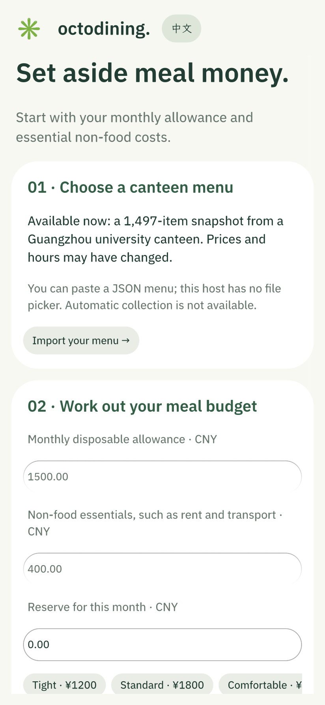
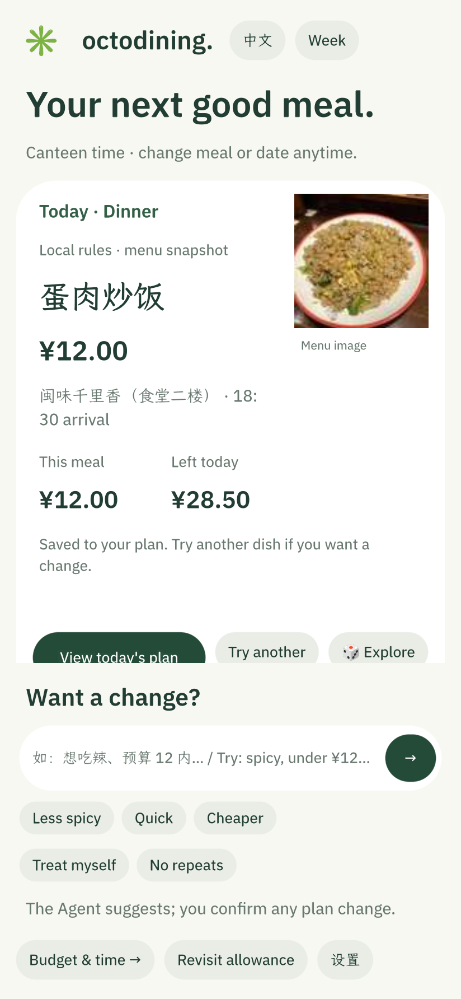
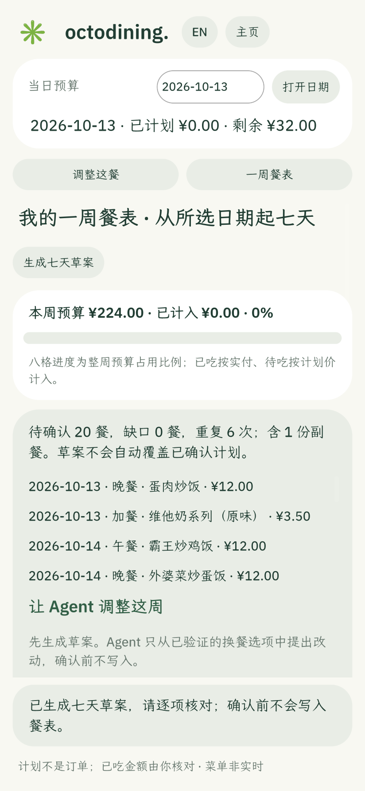
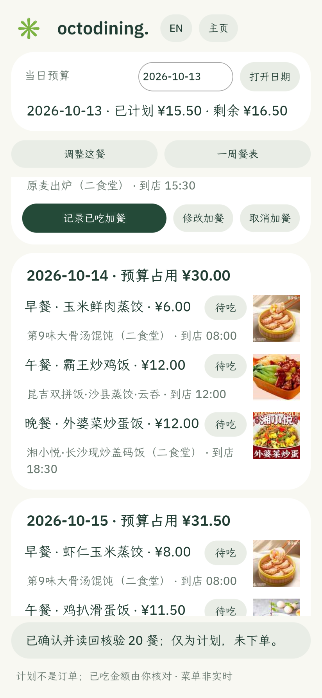
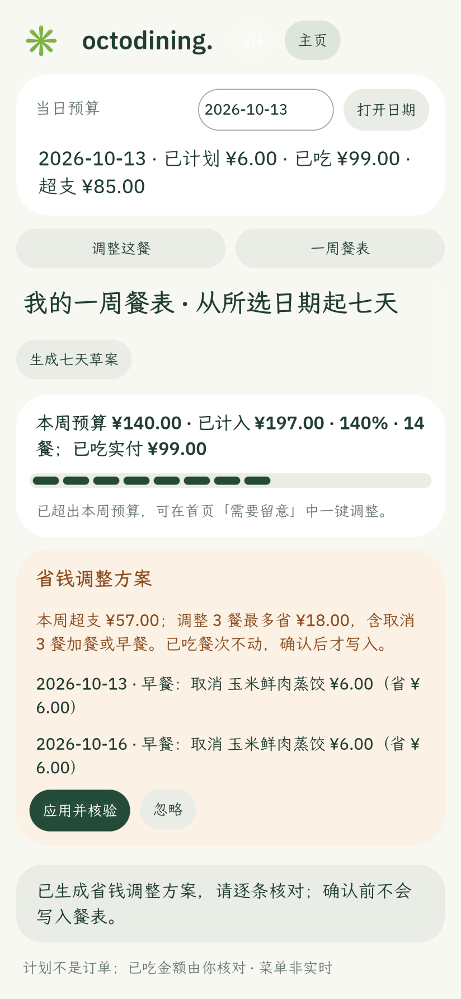

# OctoDining

[中文说明](README.md) · **English**

**Open the app and see your next meal.** OctoDining turns a monthly disposable allowance into a daily dining budget. It shows an existing confirmed meal first, or suggests a canteen dish to review and confirm. You can draft a seven-day plan, change individual meals, and record what you actually paid. An optional Octos Agent can compare up to three real candidates; the user confirms changes.

This is a native **OctoSense / OctoScript / Makepad** prototype for students. It bundles a 1,497-item historical canteen snapshot from a Guangzhou university. On first launch, you can also paste a JSON menu for another canteen. Menu prices, hours and images are snapshots, not proof of live availability, nutrition or allergen safety.

**For judges — the real Agent loop:** [15-second 1.2.2 evidence reel](docs/demo/octodining-122-agent-evidence-reel.mp4) · [original Shell record and three screenshots](docs/evidence/shell-ui122-minimax-20261004.json) · [judging checklist](docs/AGENTIC_JUDGING.md). MiniMax-M3 compared candidates for an existing dinner plan and suggested candidate 3. The user confirmed it; the app persisted and read back the plan. The reel edits actual screenshots; it is not a continuous recording. The separate 1.7.0 Shell run received HTTP 429 and **did not obtain a model suggestion**. **Current signed 1.11.1 week-plan Agent loop** (real MiniMax-M3 proposals, apply-to-draft, confirm and read back; recorded on 1.11.0 — 1.11.1 is a UI declutter plus a week-window anchoring fix, Agent calls unchanged): [framebuffer recording and key frames](docs/evidence/shell-week-agent-1110-20261012.md).

**Current 1.12.0 UI** (card-host native captures, not model evidence; [captures and change notes](docs/evidence/ux-1120-20261013.md)):

| Onboarding · one-tap presets | Home · checkable reason line, 🎲 Explore | Candidates · "leaves ¥X today" preview |
| :---: | :---: | :---: |
|  |  |  |

| First week draft | Week plan confirmed | Overspend · one-tap rebalance |
| :---: | :---: | :---: |
|  |  |  |

1.12.0 is a product-experience pass after reviewing 20 shortlisted entries: the home pick states checkable facts (amount under the meal limit, open at arrival, not eaten in 7 days); option cards preview "leaves ¥X today" before you choose; a "Cheaper" quick chip and a 🎲 Explore pick that only surfaces unrated dishes; taste feedback echoes back, "Bad" can carry a reason or block a dish everywhere, with per-item undo in Settings; "Try another" is neutral now; Agent week proposals render as per-line diff cards ([real MiniMax-M3 verification](docs/evidence/shell-agent-diff-1120-20261013.md)); meals missed in the past 7 days can be backfilled; onboarding gains presets and a "look around first" entry. The rebalance frame comes from an automated acceptance run ([notes and assertions](docs/evidence/week-rebalance-20261012.md)), not a staged shot; that panel is unchanged in 1.12.0.

These are actual **1.7.0 card-host captures**. They do not demonstrate a live model in OctoSense Shell. [Screenshots and checks](docs/evidence/next-meal-170-20261005.md).

[Watch the 35-second evidence reel](docs/demo/octodining-170-evidence-reel.mp4) · [Sources and reproduction](docs/demo/README.md). This is an edit of genuine screenshots with an original synthesized soundtrack, not a continuous screen recording or proof of a successful 1.7.0 model suggestion.

Onboarding asks for monthly disposable allowance, non-food fixed costs and a reserve. It estimates a daily dining budget over 30 days. You can use the bundled menu or paste a JSON menu with a source, update date, time zone, prices and business hours; invalid records are rejected. `scripts/menu-csv-to-json.py` converts a supported CSV into pasteable JSON. The app does not yet have a file picker or automatic collection.

The home screen uses canteen-local time to select the next uneaten meal. A provenance line marks whether advice comes from the local rule engine or a linked system Agent. Candidates expand into a detail panel (category, meal cap, arrival-hours check, recent repeats, on-device taste history, menu snapshot date). The weekly draft skips elapsed meals, shows any gaps and daily totals, and is written only after confirmation; a weekly budget bar counts eaten meals at the amount actually paid and the rest at plan prices. When the week runs over budget, the Heads up card offers a one-tap rebalance: the local engine lists cheaper swaps, or drops snack/breakfast meals — main meals are never dropped — and nothing is written until you confirm and it is read back. Further alerts follow up on planned meals never confirmed in the last 7 days, and on menu snapshots older than 30 days. The draft is **rule-generated, not Agent-generated**. Menu names and stores remain Chinese because no verified translations are available. Bundled product images ship offline in the bundle; custom menus currently use text-only cards. Taste feedback echoes back what was learned, can carry a reason or block a dish from every pick, and any record can be removed per item in Settings; a skipped dish is never penalised. Meals missed within the past 7 days can be backfilled with the amount actually paid.

Version 1.7.0 passed native card-host feature checks. A [same-version Shell run](docs/evidence/shell-170-20261005.md) verified loading, first-use Agent consent, a request entering Octos, and manual save/read-back/restart after the provider returned HTTP 429. **It did not obtain a model suggestion.** A successful real MiniMax loop remains proven for **1.2.2** only. See [contest readiness](docs/CONTEST_READINESS.md). The frozen `qualifier-2026-10-04-final` tag still points to that earlier version.

**Version 1.8.0 is in development:** it adds an Agent proposal for swaps in the unconfirmed seven-day draft. See the [implementation and validation boundary](docs/evidence/agent-week-180-20261006.md). This environment cannot run the host, so there is no same-version runtime capture or successful model suggestion yet.

To run a development preview, follow the [official OctoScript quickstart](https://github.com/OctoSense-org/OctoScript-App-Design-Flow/blob/main/docs/QUICKSTART.md):

```sh
python3 scripts/dev_bundle.py --output .local-state/preview-bundle
OCTO_CLI=/path/to/OctoScript-App-Design-Flow/tools/octo
"$OCTO_CLI" check .local-state/preview-bundle
"$OCTO_CLI" run .local-state/preview-bundle --port 8141 --hidden --detach
```

The preview uses an unsigned copy so card-host can run without changing the signed release. It does not prove Shell Agent integration. Run `python3 scripts/test-basic-app.py`, `python3 scripts/test-language.py`, `python3 scripts/test-week-draft.py`, `python3 scripts/test-custom-menu.py` and `python3 scripts/test-rebalance.py` separately for local feature checks; each uses its own unsigned copy. Code uses [Apache 2.0](LICENSE-CODE); the license does not grant rights to third-party menu data or images. See [data provenance](docs/DATA_PROVENANCE.md) and [privacy](docs/PRIVACY.md).

For the current App Hub process and the status of this bundle, see the [submission checklist](docs/APP_HUB_SUBMISSION.md). Version 1.7.0 is signed as `windy664` and passed the updated Hub's signed gate; the scan packet was made before signing. [App Hub submission #117](https://github.com/OctoSense-org/OctoSense-App-Hub/issues/117) uses the immutable `apphub-v1.7.0` tag and awaits maintainer review. The publisher states that they hold the rights to redistribute the menu data and photos; independent written evidence has not been attached.
