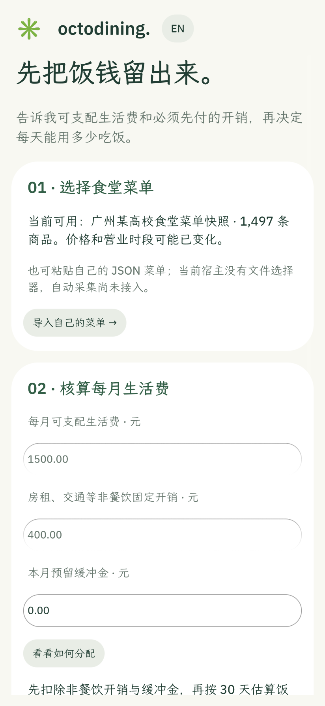
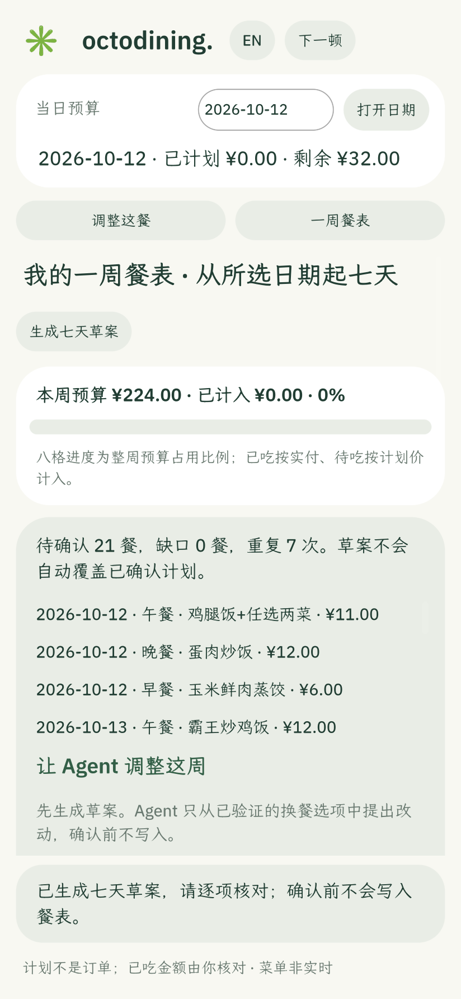
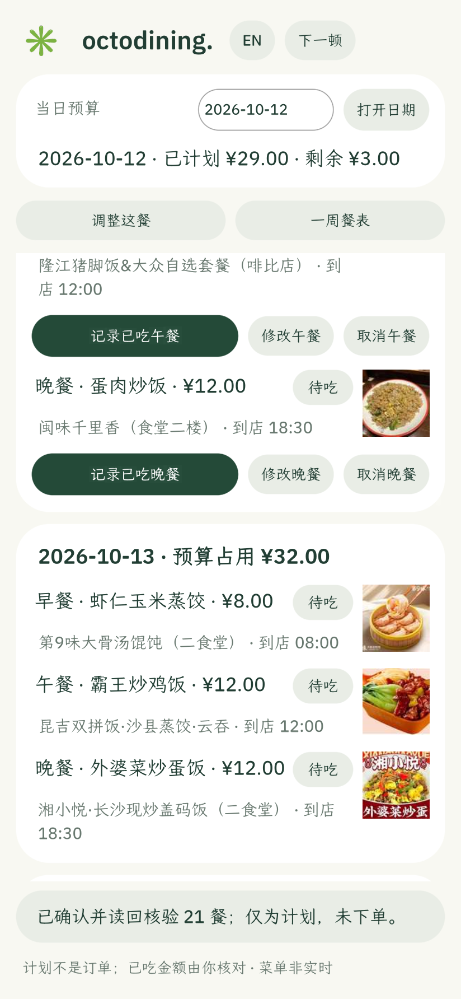
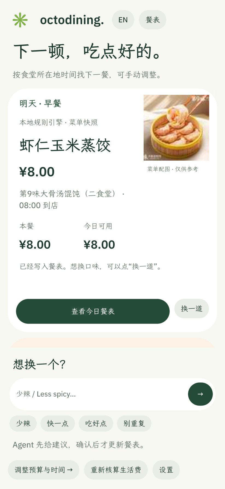
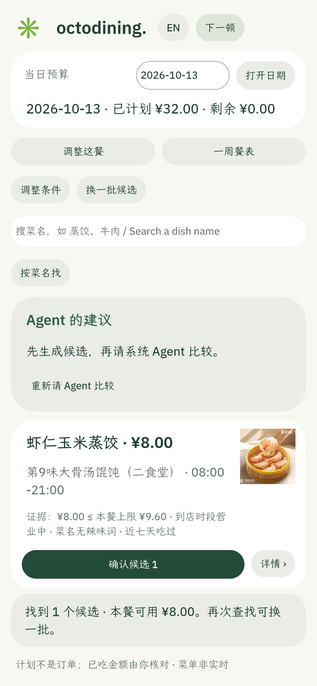
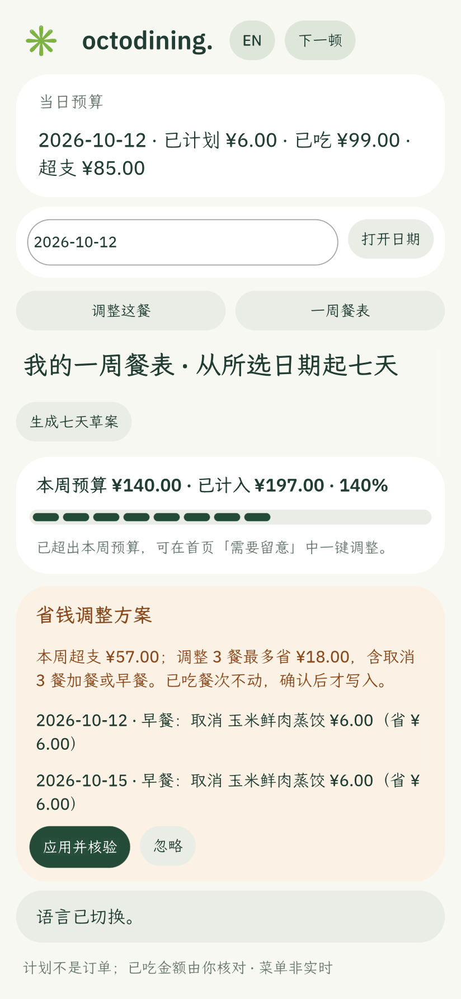

# OctoDining · 好好吃饭

**中文** · [English](README.en.md)

打开就知道下一餐吃什么。OctoDining 把每月可支配生活费变成每日餐饮预算，首次设置就生成一周餐表草案，确认后首页按餐表执行；没有计划的餐次才推荐一道可确认的菜。用户可以逐餐修改、重新生成草案，并记录实际花费。Agent 可以比较当前真实候选，重要变更仍由用户确认。

这是面向学生的 **OctoSense / OctoScript / Makepad** 原生应用原型。随包菜单是广州某高校食堂的 1,497 条历史快照；也可在首次引导粘贴自己食堂的菜单 JSON。价格、时段和配图不代表实时可售、营养或过敏安全。

**评委先看 Agent 闭环：** [15 秒 1.2.2 真实 Agent 证据剪辑](docs/demo/octodining-122-agent-evidence-reel.mp4) · [同一次 Shell 联调原始记录和三张截图](docs/evidence/shell-ui122-minimax-20261004.json) · [按评分项核验](docs/AGENTIC_JUDGING.md)。MiniMax-M3 在已有晚餐计划上比较候选并建议候选 3；用户亲自确认，应用保存计划并读回核验。剪辑由真实截图制成，并非连续录屏。**1.7.0 的 Shell 测试遭遇 429，没有取得同版模型建议**；下方 1.7.0 画面用于展示后续产品功能，不能与 1.2.2 Agent 证据视作同一次运行。**当前签名版 1.11.1 的整周 Agent 闭环录屏**（真实 MiniMax-M3 提议、应用到草案、确认读回；录于 1.11.0，1.11.1 为界面精简与周窗口锚点修复、Agent 调用逻辑相同）：[帧缓冲录屏与关键帧](docs/evidence/shell-week-agent-1110-20261012.md)。

**当前 1.11.4 界面**（card-host 原生截图，非模型证据；[画面与改动说明](docs/evidence/ui-planfirst-1114-20261012.md)）：

| 首次使用 | 引导完成 · 首周餐表草案 | 确认后的一周餐表 |
| :---: | :---: | :---: |
|  |  |  |

| 首页 · 餐表中的下一餐 | 候选 · 约束证据 | 超支 · 一键重平衡 |
| :---: | :---: | :---: |
|  |  |  |

重平衡画面来自自动化验收运行（[说明与断言](docs/evidence/week-rebalance-20261012.md)），不是摆拍；该面板在 1.11.4 未变动。

以下为 1.7.0 **card-host 原生运行截图**；不是 OctoSense Shell 的模型联调证据。[更多截图与验证](docs/evidence/next-meal-170-20261005.md)。

[观看 35 秒演示剪辑](docs/demo/octodining-170-evidence-reel.mp4) · [视频素材与复现说明](docs/demo/README.md)。视频由上述真实截图、七日餐表验收截图和 Shell 局部联调截图剪辑，配原创合成音乐；它不是连续屏幕录制，也不证明 1.7.0 已获得模型建议。

## 当前可做

- **首次设置：** 输入每月可支配生活费、非餐饮固定开销和缓冲金，按 30 天估算每日饭钱。选择内置菜单，或粘贴带来源、更新日期、UTC 时区、价格和营业时段的 JSON；无效或重复数据会被拒绝。`scripts/menu-csv-to-json.py` 可把指定 CSV 转成可粘贴 JSON。当前没有应用内文件选择器或自动抓取。
- **下一餐：** 按食堂当地时间找未吃的下一餐，先显示已确认计划，否则提供预算内推荐；可换菜、查看候选、确认或记录实际消费，超支如实显示。推荐卡标注来源（本地规则引擎 / 系统 Agent 联调状态），候选可展开「详情」核对分类、到店时段、近七天重复与口味记录。单餐页允许请求宿主 Octos Agent 比较最多三个候选；无模型仍能手动选择。
- **七日餐表：** 生成草案、查看缺口和每日预算，确认后一次写入并读回；可逐餐修改、取消、撤销已吃记录。本周预算进度条按「已吃计实付、待吃计计划价」实时更新；周超支时首页「需要留意」给出一键重平衡入口——本地引擎逐条提出更便宜的替换、或取消加餐/早餐（午晚正餐从不取消），用户逐条核对确认后才写入并读回。另有未打卡跟进（过去 7 天计划未确认）与菜单快照超过 30 天的过期提醒。草案由应用规则生成，不声称是 Agent 编排。候选排除明显加料、纯主食和小份，但无法证明份量或营养。
- **双语和图片：** 界面可切中文 / English 并持久化；菜名和店名仍为数据源中文。内置菜单 1,209 条商品有关联的非默认图片 URL，按商品加载；无图则显示文字。用户导入的菜单目前不加载外部图片。

1.7.0 的卡片宿主功能测试已通过。[同版 Shell 测试](docs/evidence/shell-170-20261005.md)确认应用加载、Agent 首次授权、请求进入 Octos，以及模型限流时的人工选择、保存读回与重启恢复；这次供应商返回 429，**没有得到模型建议**。真实 MiniMax 建议的完整联调证据仍属于 1.2.2。已冻结的 `qualifier-2026-10-04-final` 标签仍指向旧版，不因开发版更新而改写。

**1.8.0 开发中：** 七日草案新增 Agent 换餐提案入口。源码与包预检见[实现及待验收项](docs/evidence/agent-week-180-20261006.md)；当前受执行环境限制，尚无 1.8.0 宿主运行、模型建议或新截图，不能用上面的 1.7.0 证据代替。

## 运行开发预览

依照[官方 OctoScript 快速上手](https://github.com/OctoSense-org/OctoScript-App-Design-Flow/blob/main/docs/QUICKSTART.md)准备 `tools/octo`，然后运行：

```sh
python3 scripts/dev_bundle.py --output .local-state/preview-bundle
OCTO_CLI=/path/to/OctoScript-App-Design-Flow/tools/octo
"$OCTO_CLI" check .local-state/preview-bundle
"$OCTO_CLI" run .local-state/preview-bundle --port 8141 --hidden --detach
curl --fail http://127.0.0.1:8141/snap
curl --fail http://127.0.0.1:8141/quit
```

这从已签名的发布包复制出**无签名开发副本**供 card-host 运行，原包的签名不会被修改；预览不能证明 Shell Agent 接通。功能验收可分别运行 `python3 scripts/test-basic-app.py`、`python3 scripts/test-language.py`、`python3 scripts/test-week-draft.py`、`python3 scripts/test-custom-menu.py` 和 `python3 scripts/test-rebalance.py`；测试同样使用隔离的无签名副本。

应用源码模板为 `scripts/main.splash.in`，`bundle/main.splash` 是嵌入菜单后的生成文件；`bundle/` 是 App Hub 检查对象。OctoSense Shell 是目标宿主，Rinx 聊天分享是可选扩展。架构与边界见[架构说明](docs/ARCHITECTURE.md)，产品流程见[产品定位](docs/PRODUCT_POSITIONING.md)，隐私见[数据说明](docs/PRIVACY.md)。

按最新官方 Flow 准备 App Hub 发布时，请看[提交状态与步骤](docs/APP_HUB_SUBMISSION.md)。当前 1.7.0 包以 `windy664` 签名，并通过更新后 Hub 的签名检查；审查包已在签名前生成。[App Hub 投稿 #117](https://github.com/OctoSense-org/OctoSense-App-Hub/issues/117) 已提交，使用固定标签 `apphub-v1.7.0`，等待维护者审查。发布者已说明对菜单和照片拥有公开分发权，书面凭据尚未附仓库。

代码采用 [Apache 2.0](LICENSE-CODE)。内置菜单及照片的权利范围按发布者说明记录在[数据来源说明](docs/DATA_PROVENANCE.md)，尚未附独立凭据；代码许可不自动涵盖菜单与图片。当前没有订餐、付款、实时库存、营养或过敏原核验。
