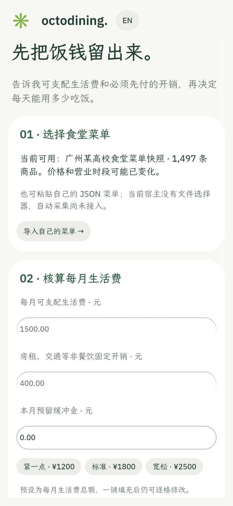
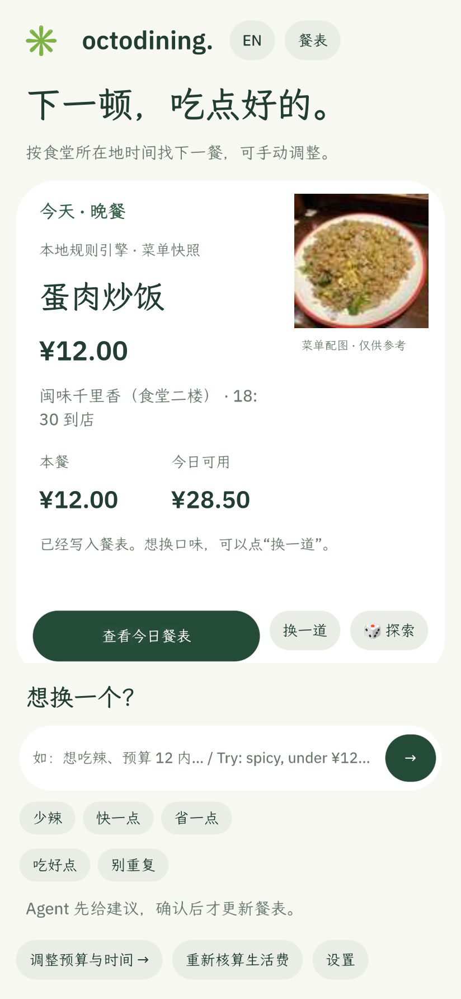
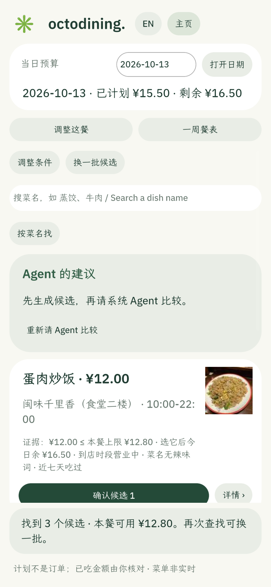

# 1.12.0 产品体验改版 · 画面与改动说明 · 2026-10-13

当前签名版 **1.12.0**（windy664 签名，`hub check` PASSED）。本轮是竞品走查后的产品体验改版：对比了 App Hub 上 20 个初赛入围作品的界面与交互（TraceShop、trip-guardian、拾意、pantry-steward、OnCue、无提醒 Agent、BuWei 等），把"推荐理由可见化、改动先预览、反馈有回声"三类高分共性落到了自己的业务里。所有截图为 card-host 原生帧缓冲实拍，非模型证据；Agent diff 卡的真实模型验证见 `shell-agent-diff-1120-20261013.md`。

## 改动清单

**首页推荐可核对（为什么是它）**
- 推荐理由从套话改为可核对事实行：`低于本餐上限 ¥0.80 · 到店时段营业中 · 近七天未吃`（英文 `¥0.80 under the meal limit · open at arrival · not eaten in 7 days`）；暂无历史时如实写"暂无历史计划"。
- 新增 🎲 探索位：只在还没评价过的餐品里挑，防止推荐越用越窄；理由行前缀 `🎲 探索：这道还没评价过`；全部评过时如实提示并回到常规推荐。
- 快捷指令 chips 增加「省一点」，两行排列（英文界面不再溢出）；输入框占位符改为具体示例「如：想吃辣、预算 12 内…」。

**候选决策前预算预览**
- 候选卡证据行新增 `选它后今日余 ¥X`（不足时显示 `会超今日预算 ¥X`），把超支从"事后提醒"变成"选前可见"。

**口味反馈 2.0（反馈有回声、可撤销）**
- 「好吃」与「不行」都有 status 回声（"已记住：以后少推荐「X」（吃腻了）。设置里可随时撤销。"）。
- 「不行」先追问理由 chips：太贵 / 太油 / 吃腻了 / 不想说；理由写入口味记录并在徽标中显示（`✗ 你给过差评 ×1（吃腻了）`）。
- 新增「以后都不要这道菜」：拉黑后该菜不再出现在首页推荐、候选、草案与重平衡替换里（`taste_blocked` 过滤 + 评分压底 99999）。
- 「换一道」改为中性动作：跳过不再累积评分惩罚（路过 ≠ 拒绝）。
- 设置页口味记录可逐条「移除」（撤销入口），并显示拉黑/理由标记。

**Agent 整周提议 = 逐条 diff 卡**
- 成功提议不再是一段文字，而是每张卡一行：`日期 · 餐次` + `旧菜 ¥x  →  新菜 ¥y` + 绿色 `省 ¥z`（同价标"同价换口味"）；仍须点「应用建议到草案」再「确认整周草案」，两道闸门不变。
- 结果摘要行保留（提议 N 处换餐、预计共省、理由），详情看卡片。

**补记与引导**
- 过去 7 天漏确认的餐次可以「补记」实付金额（原为仅限当天）；首页提醒文案同步改为"可补记实付或取消"。
- 新手引导 02 卡增加生活费预设一键填充（紧一点 ¥1200 / 标准 ¥1800 / 宽松 ¥2500，填完可逐格改）；03 卡新增「先逛逛，晚点再核算 →」体验入口（不保存预算也能先看首页推荐）。

## 画面

| 首次使用（预设+先逛逛） | 首页（理由行+探索位） | 候选（预算预览） |
| :---: | :---: | :---: |
|  |  |  |

英文界面与餐表确认画面同目录（04/05/03）；重平衡界面未变，沿用 `rebalance-proposal.png`（取自 2026-10-12 验收运行）。

## 验证

- 八套 card-host 回归在最终源码上全部通过（test-taste 更新为"不行 → 选理由"新流程并断言理由落盘 + 设置页逐条移除；其余七套无改动通过）。
- 远程桥功能断言：预设填充（1200/300/100 → 每天约 ¥26.66 并给出预算偏紧提示）、「先逛逛」直达首页、探索按钮与理由行在场。
- Agent diff 卡的真实 MiniMax-M3 验证：见 `shell-agent-diff-1120-20261013.md`。
- 截图重截后人工逐张查看（本目录画面即最终版）。
